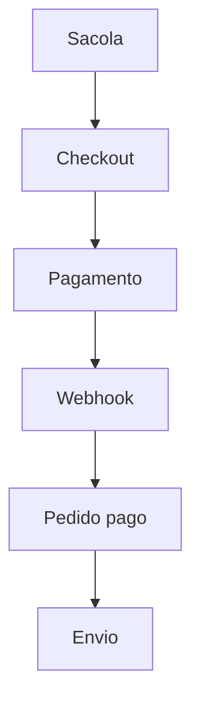

# Checkout YBRD

## Fase 0 · Descoberta

A loja usa React 19, TanStack Start/Router, Vite/Nitro e Tailwind. A sacola existente é um contexto React com armazenamento versionado e sincronização entre abas. `Storefront` concentra a vitrine, cabeçalho e painel da sacola. `ProductPreview` e `/produto/$produto` já oferecem detalhes e variantes por tamanho. O catálogo atual é estático e não possui estoque verificável.

A conta já passa por `/api/conta/`, com cookies HttpOnly, sessão revogável e Supabase. A migração existente contém `profiles`, `user_roles`, `security_events` e `has_role`. Reutilizar esse controle de sessão e os tokens `--ink`, `--cream`, `--signal`, a fonte dos títulos e a mono. Os comandos existentes são `npm run lint`, `npx tsc --noEmit`, `npm test` e `npm run build`.

A sacola envia apenas slug, tamanho e quantidade. O servidor revalida dados contra `products` e `product_variants`. A criação do pedido recalcula preço e frete, usa chave de idempotência, reserva estoque em transação e registra snapshots. A confirmação consulta o gateway e só então atribui edições e libera o pedido para envio. Reenvio de webhook e tentativa repetida de checkout devem retornar o resultado existente. Expiração libera reservas e pagamento tardio segue para revisão.

Tabelas previstas: `products`, `product_variants`, `carts`, `cart_items`, `stock_reservations`, `edition_units`, `addresses`, `orders`, `order_items`, `order_events`, `payments`, `webhook_events`, `coupons`, `coupon_redemptions`, `settings`, `return_requests` e fila de e-mail. Funções SQL encapsulam operações atômicas. Rotas de servidor no Nitro cuidam de sacola, CEP, frete, checkout, pagamentos, webhook, pedidos e administração. Elas reaproveitam a mesma origem e sessão do site, sem criar uma segunda API de autenticação.

A mudança mínima de catálogo é relacionar SKU e tamanho ao slug existente. Cadastro comercial começa inativo até confirmar estoque, dimensões, peso e tiragem. Produtos gerados são referências visuais e precisam corresponder às peças reais antes de ativar vendas. Para convidado, sacola local guarda só identificadores e quantidades. Endereços, CPF, tokens de pagamento e credenciais ficam fora do armazenamento persistente do navegador.

Configuração prevista: `SUPABASE_URL`, `YBRD_SUPABASE_SECRET_KEY`, `YBRD_SITE_ORIGIN`, `YBRD_CHECKOUT_ENABLED`, `YBRD_MELHOR_ENVIO_TOKEN`, `YBRD_MELHOR_ENVIO_SANDBOX`, `YBRD_MP_ACCESS_TOKEN`, `YBRD_MP_WEBHOOK_SECRET`, `YBRD_PAYMENT_MOCK`, `YBRD_EMAIL_API_KEY`, `YBRD_EMAIL_FROM`. Valores de frete, parcelamento e cupons vêm do banco. Nenhuma migração é aplicada em produção por este trabalho.

O texto anexado termina na fase 6. As regras brasileiras de venda, privacidade, troca e devolução exigem dados reais da empresa e revisão antes de liberar pedidos. Um checkbox genérico não substitui políticas publicadas. O lint inicial apontou 935 erros e 10 avisos, quase todos de formatação. Essa linha de base foi registrada antes de editar código.

## Fase 1 · Estoque e pedidos

Migração `20261111010000_commerce.sql` cria o catálogo comercial, reservas, edições, pedidos e auditoria com RLS e permissões restritas. Reserva e confirmação bloqueiam as linhas em ordem determinística. A expiração libera o estoque e a confirmação idempotente numera as peças. O catálogo entra inativo, com estoque zero e medidas pendentes. Execute as migrações em um Supabase de teste antes de publicar e valide concorrência, expiração, RLS e reversão de transação. Nenhum banco de produção foi acessado.

## Fase 2 · Sacola

A página `/sacola` e o painel lateral compartilham o mesmo componente. Visitantes mantêm a sacola versionada no navegador, com fallback em memória. Contas mesclam os itens no banco uma vez por identificador de importação. O servidor limita quantidades, atualiza preços em centavos e avisa sobre itens indisponíveis. A prévia continua acessível com vendas desativadas. A ligação de frete e cupom segue nas próximas fases. Lint, typecheck, 38 testes e build passaram.
